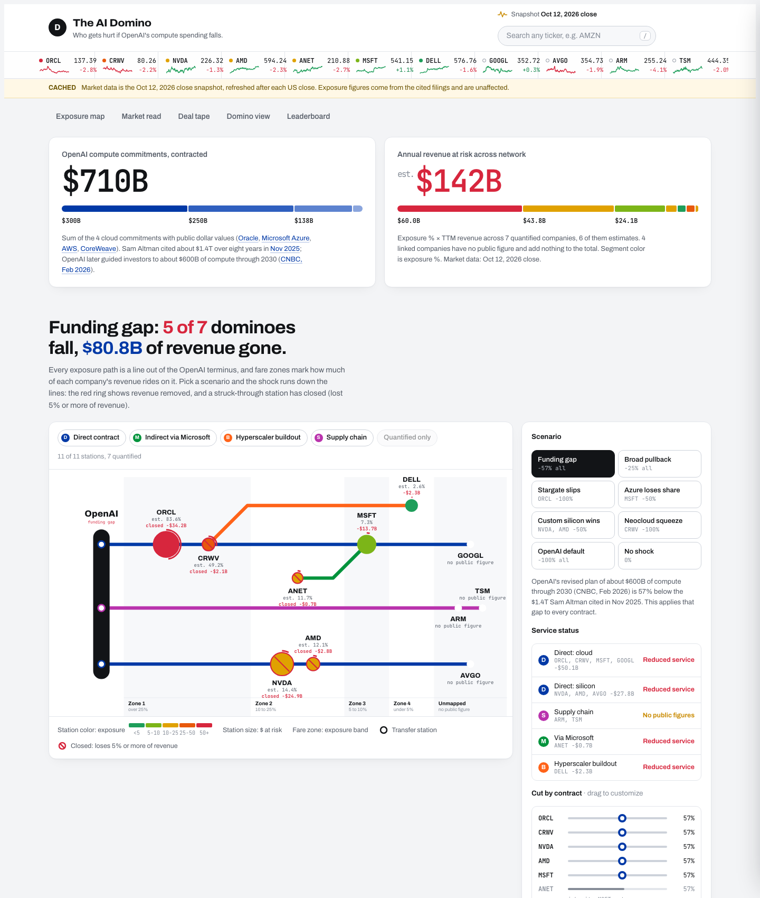

# The AI Domino

Which public companies get hurt if OpenAI's compute spending falls? This is a live map of that exposure, drawn as a transit system. Each dependency path is a line out of the OpenAI terminus, companies are stations, and fare zones show how much of each company's revenue rides on OpenAI. Every exposure number links to the filing or report it came from.



## What it shows

- **Exposure map.** Direct contracts (Oracle, CoreWeave, Microsoft, NVIDIA, AMD, Alphabet, Broadcom), second-order paths (Arista via Microsoft, Dell via CoreWeave) and the supply chain (Arm, TSMC). Station color is exposure %, station size is dollars at risk, and the fare zone is the exposure band.
- **Stress test.** Eight scenarios plus per-contract levers. Second-order companies inherit their intermediary's cut. A station "closes" when it loses 5% or more of revenue. One scenario, the funding gap, applies the 57% gap between OpenAI's ~$600B compute plan through 2030 and the $1.4T headline.
- **Market read.** Six-month price index by exposure tier, plus a risk matrix of exposure against the share of market value tied to OpenAI.
- **Deal tape.** Every dated OpenAI compute deal from January 2025 to October 2026. Marker area is the dollar value, and each marker links to its source.
- **Domino view for any stock.** For 48 tracked tickers: the top five 13F holders, the five most-correlated tickers with beta, a shock simulator (including "back to the 200-day average" and "P/S reverts to the universe median"), and a five-part bubble gauge.
- **Leaderboard** with sorting, filters, ticker search (`/`) and CSV export.

## Integrity rules

1. Every exposure number traces to a source citation shown in the company panel: 10-K, 10-Q, 8-K, 6-K, earnings calls, company releases, or CNBC/WSJ/Bloomberg reporting.
2. Estimates carry an `est.` prefix, and every exposure shows an "as of" date.
3. Companies with no citable OpenAI link are left out: Super Micro, Vertiv and Eaton are listed as screened out, with the filing that was checked.
4. If market data cannot load, the page falls back to the bundled snapshot and says so in a banner.

## Method

- **Exposure %** is annual OpenAI-linked revenue divided by trailing-twelve-month revenue.
  - Microsoft's OpenAI revenue is disclosed ($24.1B in FY26).
  - Where only a multi-year contract is public, its value is spread evenly over the term.
  - Second-order paths multiply a disclosed customer share by that customer's OpenAI share.
- **$ at risk** = exposure % × TTM revenue.
- **Spillover** in the domino view = a neighbor's 1-year daily beta × the shock. This is historical co-movement, not causation.
- **Bubble gauge**: five capped components of 20 points each:
  - P/S from 3 to 30×
  - P/E from 15 to 90×
  - 1-year return from 0 to 150%
  - premium to the 200-day average from 0 to 50%
  - 60-day volatility from 20 to 80%

  It measures how stretched a stock is. It does not predict a crash.

## Data

| File | Built by | Contents |
|---|---|---|
| `data/snapshot.json` | `scripts/refresh.py` | Price, market cap and TTM revenue for the OpenAI network |
| `data/history.json` | `scripts/refresh.py` | Six months of daily closes |
| `data/universe_all.json` | `scripts/universe.py` | 48-ticker domino universe: valuation, 13F holders, correlations, one year of closes |

Sources are the Yahoo Finance chart API for prices, Nasdaq for market cap, financials and institutional holdings, and SEC XBRL for TTM revenue. Both scripts use only the Python standard library and `curl`:

```bash
python3 scripts/refresh.py
python3 scripts/universe.py
```

Add tickers to the domino universe by listing them in `scripts/extra_tickers.txt`, one per line.

## Run locally

It is a single static page with no build step:

```bash
python3 -m http.server 8000
```

Then open http://localhost:8000.

Not investment advice.
